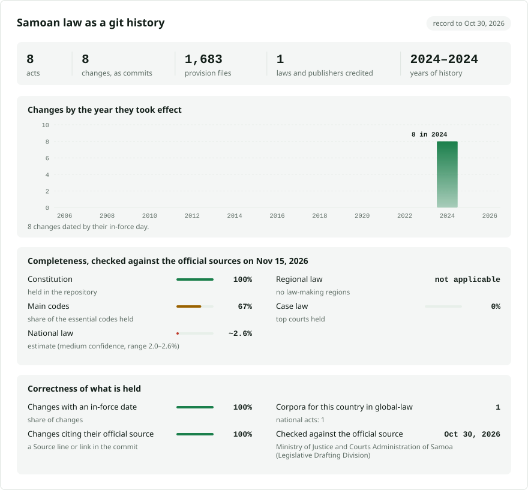

# Samoa: law history in git

<picture>
<source media="(prefers-color-scheme: dark)" srcset="data/effort-dark.svg">

</picture>

The law of Samoa as a git history: one file per provision (an article of the Constitution, or a section, Part heading or Schedule of an Act), one commit per version on the day it is in force from, and the law that made each change as the commit's author. The Ministry of Justice and Courts Administration publishes only the current revised text of each Act, so each act has one version so far, credited to the publisher; a later revision is added as a new commit, so that `git log` and `git blame` show each change from this version on.

Part of [lexifina/global-law](https://github.com/lexifina/global-law), one git history for every country's law: this is Samoa's national law, which global-law reads at `samoa/national/acts/`.

**What is in it now:** the Constitution of the Independent State of Samoa 1960 and 222 Acts and Ordinances of Samoa (14 of them Ordinances), among them the Crimes Act 2013, Criminal Procedure Act 2016, Evidence Act 2015, Labour and Employment Relations Act 2013, Companies Act 2001, Judicature Act 2020, Family Court Act 2014 and Property Law Act 1952, each in one version, the Ministry's official revised text as at 31 December 2024: 12,270 provision files in all. [`data/versions.json`](data/versions.json) lists every act with its source PDF, and each act's folder has a `README.md` listing its provisions.

Each Act is in `act/<year>/<name>/` and each Ordinance in `ordinance/<year>/<name>/` ([`STRUCTURE.md`](STRUCTURE.md)) and each Ordinance in `ordinance/<year>/<name>/` ([`STRUCTURE.md`](STRUCTURE.md)) (`act/2013/labour-employment-relations/sec-040.md` is section 40, Annual leave, of the Labour and Employment Relations Act 2013); the Constitution is in [`constitution/constitution/`](constitution/constitution/), one file per article. [`data/paths.json`](data/paths.json) maps each act id to its folder.

The text is in English, as the Ministry's revised PDFs print it, one paragraph per line. The Constitution is also authoritative in Samoan; that text is not part of this record.

## Questions as git commands

| Question | Command |
| --- | --- |
| Every change to section 40 (Annual leave) of the Labour and Employment Relations Act | `git log -p --word-diff --follow -- act/2013/labour-employment-relations/sec-040.md` |
| Which version wrote each line of section 40? | `git blame act/2013/labour-employment-relations/sec-040.md` |
| Every version of section 40, with the day each is in force from | `git log --follow --diff-filter=AM --format="%h %(trailers:key=In-force,valueonly,separator=) %an" -- act/2013/labour-employment-relations/sec-040.md` |
| Section 40 as the record holds it on 1 January 2026 | `python tools/on.py 2026-01-01 act/2013/labour-employment-relations sec-040` |

**Outside git**, we also host this record publicly, for free:

- **[Ask Claude about Samoan law](https://global-law.lexifina.com/v1/try_claude?country=samoa)**: opens Claude with a first question ready.
- **[Ask ChatGPT](https://global-law.lexifina.com/v1/try_chatgpt?country=samoa)**: the same question in ChatGPT.
- **[Search Samoan law on our site](https://lexifina.com/law?country=samoa&q=annual+leave)**: a search for "annual leave", with each provision's text and its versions, no account needed.
- **[Developer REST API](https://global-law.lexifina.com/v1/search_law?query=annual+leave&jurisdiction=samoa)**: the same search as JSON, with no key. See the [documentation here](https://lexifina.com/api/global-law).

Both assistants read the record through the free Global law connector (MCP, `https://global-law.lexifina.com/mcp`); the first time, the chat gives you the link that adds it. Ask in English.

**Host it yourself easily.** All it takes is git and Python, and the tools run on your machine:

```sh
git clone --depth 1 https://github.com/lexifina/global-law && cd global-law
python3 tools/countries.py add samoa/national/acts
python3 tools/law.py show 2026-01-01 samoa/national/acts/act/2013/labour-employment-relations/sec-040.md
```

Opened in Claude Code, Cursor, VS Code or Codex, the clone also starts a local MCP server with the same tools ([MCP.md](https://github.com/lexifina/global-law/blob/main/MCP.md)).

## Dates

Each law commit is dated at noon, Pacific/Apia, and carries its day in its `In-force:` trailer:

- for every act here, 31 December 2024, the day the Ministry's Revision Notes say the revised text is "as at". It is not the day the act took effect (the Labour and Employment Relations Act commenced on 5 April 2013, the Constitution on 1 January 1962), nor proof of the day any amendment did;
- `tools/on.py` reads the trailer, so it shows nothing for a day before 31 December 2024: the record holds no older text.

Every law commit is authored by the publisher, `Ministry of Justice and Courts Administration of Samoa (Legislative Drafting Division)`, as the oldest version available (`Kind: publisher`): no line is credited to an amending Act, because without the earlier text nobody can tell which words an amendment wrote. The move of every act to its present folder (2026-11-10) is a commit of its own (`Kind: documentation`) that changes no law text; `git log --follow` and `git blame` see through it.

## How it is checked

- `tools/check_repo.py` reads every version back from git on the day it is in force from and on the day before, and compares it with the corpus the repository was built from: 0 mismatches (see [`REPRODUCE.md`](REPRODUCE.md)).
- A second build from the same corpus into an empty folder gave identical hashes for every commit and tag; the corpus's sha256 is in [`data/corpus.sha256`](data/corpus.sha256).
- Every commit's trailers parse; there are no merge commits, commit dates never go back and none is in the future.
- History is append-only: newer revisions and new acts go on top (`tools/append.py`), and no published commit is rewritten.
- [vulnerabilities/](vulnerabilities/): possible drafting mistakes in this law, found by global-law's detectors and checked by hand. Not run yet.

## What it does not show

- **Every other Act of Samoa.** The Ministry's catalogue lists 269 consolidated Acts and Ordinances (the Constitution among them); 222 of them are here. 46 are held back: their PDF text did not pass the word-for-word and section-number checks (or has no text layer), and are listed in no file here until they do.
- **Any text but the revision as at 31 December 2024.** The Ministry publishes no earlier versions, and the amending Acts' own texts are not here.
- **The Samoan text of the Constitution.** Its Revision Notes and the signatures of the Constitutional Convention are left out too.
- **Some section boundaries** in the Crimes, Companies and Property Law Acts, which were read from the PDFs' plainer text layer: a few sections may sit inside the file before them (the Property Law Act has no file for sections 35 and 53).
- **Subsidiary legislation and case law** are not part of this record.

## Sources

| Source | Kind | Past versions | Notes |
| --- | --- | --- | --- |
| [Ministry of Justice and Courts Administration](https://mjca.gov.ws/legislation/legislation.html) (MJCA) | Official revised versions (Legislative Drafting Division, Revision and Publication of Laws Act 2008) | no, the current revision only | One PDF per Act, each "as at 31 December 2024", read from its text layer; retrieved on 29 and 30 October and 27 November 2026 |

## Licence

See [`LICENSE`](LICENSE). The Ministry states no licence for the legal texts, and their copyright status is not confirmed; they are reproduced with attribution and without change to their wording, only split into files and lines. Lexifina's own contributions (the arrangement of the history, the commit messages, the tables and the tools) are CC0 1.0.

No model wrote, translated or corrected legal text, and no model runs at build time; the scripts were written by Claude Code under Lexifina's direction (see [`REPRODUCE.md`](REPRODUCE.md)).

## Visualisations

- [visualisations/](visualisations/): charts drawn from this repository. Not drawn yet.

## More

From [lexifina/global-law](https://github.com/lexifina/global-law):

- [FEATURES.md](https://github.com/lexifina/global-law/blob/main/FEATURES.md): every feature, and what every corpus must support (`git blame`, `law.py`, the MCP tools)
- [FAQ.md](https://github.com/lexifina/global-law/blob/main/FAQ.md): questions and answers · [CONTRIBUTING.md](https://github.com/lexifina/global-law/blob/main/CONTRIBUTING.md): proposing changes · [MCP.md](https://github.com/lexifina/global-law/blob/main/MCP.md): the MCP server · [REPRODUCE.md](https://github.com/lexifina/global-law/blob/main/REPRODUCE.md): how it was built · [CHANGELOG.md](https://github.com/lexifina/global-law/blob/main/CHANGELOG.md)
- [FRESHNESS.md](https://github.com/lexifina/global-law/blob/main/FRESHNESS.md): how current each corpus is · [Monitoring](https://github.com/lexifina/global-law/tree/main/monitoring): whether updates are running · [WATCHING.md](https://github.com/lexifina/global-law/blob/main/WATCHING.md): how each official source is watched for changes
- [performance/](https://github.com/lexifina/global-law/tree/main/performance): how fast the tools are, measured
- [visualisations/](https://github.com/lexifina/global-law/tree/main/visualisations): charts and bridges across the world's law
- [Vulnerabilities](https://github.com/lexifina/global-law/tree/main/vulnerabilities): mistakes in legislation as published
